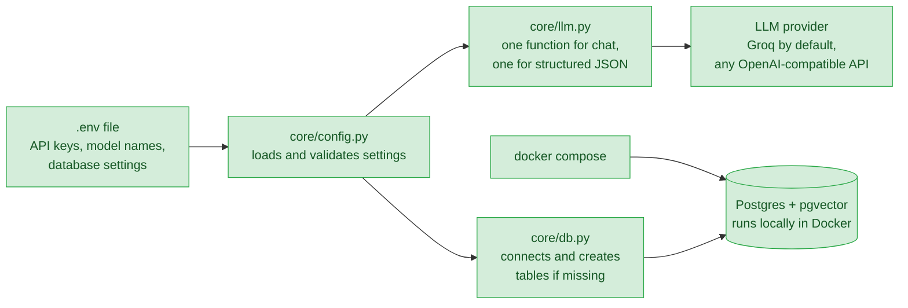
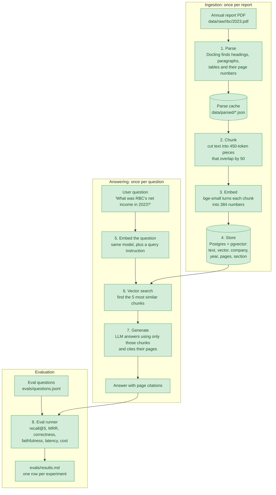
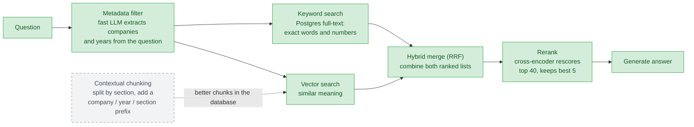
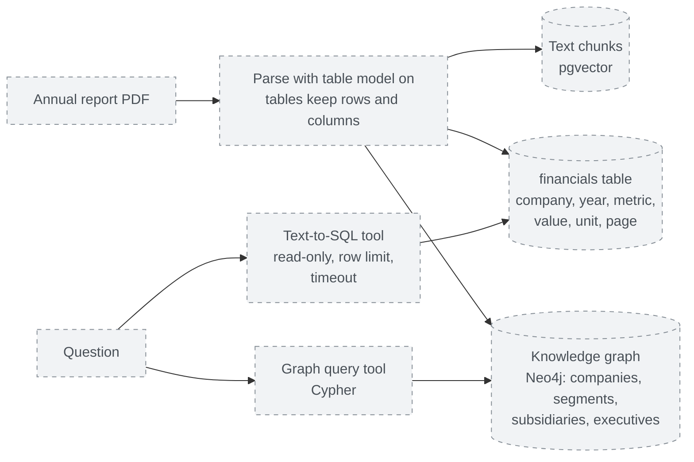
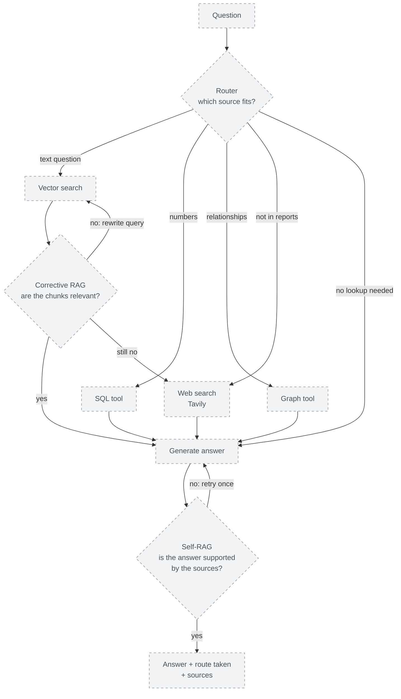
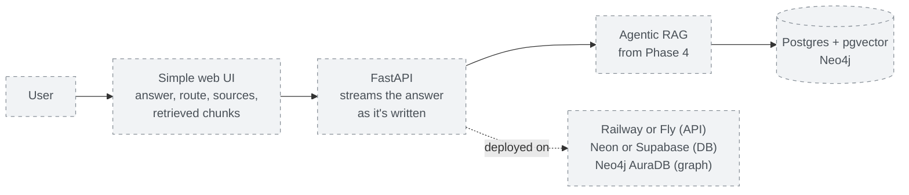

# ReportLens

Question answering over Canadian public companies' annual reports, built to demonstrate and measure 10 RAG techniques.

> Work in progress. See `CLAUDE.md` for the phase plan and `DECISIONS.md` for design choices.

## Quickstart

```bash
cp .env.example .env          # then add your free Groq API key
uv sync
docker compose up -d          # start Postgres + pgvector
uv run pytest                 # fast tests (add -m slow for tests that run real models)

# Put PDFs at data/raw/{company}/{year}.pdf, then:
uv run python scripts/ingest_all.py --companies bce,rbc,scotiabank

# Ask a question:
uv run python scripts/ask.py "How many wireless subscribers did Bell have in 2024?"
```

## Project status

| Phase | What it adds | Status |
|-------|--------------|--------|
| 0. Setup | Config, LLM wrapper, database, tests | ✅ Done |
| 1. Baseline RAG + evals | Parse → chunk → embed → store; vector search; answers with citations; eval runner | ✅ Done: baseline recorded |
| 2. Better retrieval | Contextual chunking, keyword + hybrid search, reranking, metadata filters | 🟡 In progress: filters, keyword, hybrid search and reranking built; contextual chunking next |
| 3. Structured data | Real tables, SQL tool, knowledge graph | ⬜ Planned |
| 4. Agentic layer | Router, Self-RAG, Corrective RAG | ⬜ Planned |
| 5. Ship | API, UI, deployment | ⬜ Planned |

**Corpus so far:** 12 of 20 reports ingested (BCE, RBC and Scotiabank, fiscal 2021–2024). TD and Shopify are downloaded but not yet ingested.

## Results so far

Every technique is measured on the same 31-question eval set (`evals/questions.jsonl`). Full history: [`evals/results.md`](evals/results.md).

| Experiment | Recall@5 | MRR | Correctness | Faithfulness |
|------------|----------|-----|-------------|--------------|
| Phase 1 baseline: naive chunks, vector top-5 | 0.25 | 0.15 | 0.42 | 0.92 |
| + metadata filters (company, year) | 0.52 | 0.27 | **0.53** | **1.00** |
| Keyword search + filters *(retrieval only)* | **0.84** | **0.61** | n/a | n/a |

*Retrieval-only rows score search without generating answers. The keyword row's full run hit the LLM provider's daily token limit, so answers will be scored in a re-run.*

**Does the wording of the question matter?** Most eval questions borrowed the reports' own terms, which favours keyword search. So 11 questions were rephrased in everyday words (same facts, same pages), e.g. *"How many cellphone customers did Bell have?"* instead of *"How many mobile phone subscribers…"*. Retrieval recall@5 on those 11 facts:

| Retriever | Report's wording | Everyday wording |
|-----------|------------------|------------------|
| Vector + filters | 0.50 | 0.55 |
| Keyword + filters | **0.95** | 0.32 |

Keyword search wins when the question uses the report's exact terms and collapses when it doesn't. Vector search is steady either way. On all 42 questions, the two find different correct pages: together their top-5 lists cover 34 of 39 answerable questions, against 29 for keyword alone. That gap is what the **hybrid merge (RRF)** is meant to capture.

**Hybrid search result:** recall@5 **0.62** (MRR 0.45), more balanced across wordings (0.68 report wording, 0.50 everyday wording) but *below* keyword alone overall. RRF rewards chunks that both retrievers rank fairly well, so a so-so chunk ranked about 6th by both can push out the right page that keyword search ranked 1st. Tuning RRF changed little (0.62–0.65). Yet the right page is somewhere in the combined top-20 candidates for **all 39** answerable questions: the candidates are fine, the ordering isn't. That's the job of the next step, **reranking**.

**Reranking result (preliminary):** with a cross-encoder rescoring the top 40 hybrid candidates, recall@5 rose from 0.62 to **0.88** (MRR 0.45 → 0.60) on the 33 answerable questions that finished before the LLM provider's daily limit cut the run short. A full 42-question run is still needed before it goes into the results table.

What the baseline shows, and which phase targets each problem:

- **Retrieval is the bottleneck.** In 14 of 28 answerable questions, the right pages weren't retrieved and the model refused. The model rarely makes things up (faithfulness 0.92), so better retrieval should turn straight into better answers.
- **The wrong year is retrieved.** 55% of retrieved chunks came from a different fiscal year than the question asks about, because similar reports from different years look alike to vector search. *Phase 2 metadata filters: now 14%, and recall doubled.*
- **Numbers lose their labels.** Without the table model, a figure can end up far from its row label, so the model may pick the wrong row (q001 reported the *adjusted* figure). *Phase 3 tables.*
- **Multi-report questions fail.** Comparison questions score 0: one top-5 search can't cover two reports at once. *Phase 4 agentic layer.*
- **Out-of-corpus questions are handled.** All 3 were correctly refused.

## How it works, phase by phase

How to read the diagrams:

- **Green boxes with solid borders** are built and working.
- **Grey boxes with dashed borders** are planned and not built yet.
- **Arrows** show data moving from one step to the next.

### Phase 0: Setup ✅

The foundation every later phase uses: one place for settings, one place for LLM calls, and a database.



1. **`.env`** holds everything that changes between machines: API keys, model names, database port. It's never committed.
2. **`core/config.py`** reads `.env` once and checks that every value is valid. Code never hardcodes a model name or path.
3. **`core/llm.py`** is the only way the code talks to an LLM, so every call's cost and speed is logged in one place. Switching between Groq, Gemini and Ollama only means editing `.env`.
4. **`core/db.py`** connects to Postgres and creates the tables if they don't exist yet.
5. **Postgres with pgvector** stores text and vectors (lists of numbers that capture meaning) side by side.

### Phase 1: Baseline RAG + evals ✅

The simplest complete RAG system, used as the baseline every later technique is measured against. It has two halves: **ingestion** (done once per report) and **answering** (done for every question).



1. **Parse** (`ingest/parse.py`): Docling reads the PDF's layout and returns blocks of text, each tagged with its page number and the heading it sits under. Page headers and footers are dropped. The result is cached, so each PDF is parsed only once (about 6–7 minutes per report on a laptop CPU).
2. **Chunk** (`ingest/chunking.py`): the report's text is cut into equal 450-token pieces, ignoring headings on purpose. That's what makes this the "naive" baseline. Each chunk remembers every page it came from, for citations.
3. **Embed** (`ingest/embed.py`): a small embedding model turns each chunk into a vector, so that chunks with similar meaning get similar vectors.
4. **Store** (`ingest/load.py`): chunks, vectors and metadata go into Postgres. A report that hasn't changed is skipped, so re-running is fast.
5. **Embed the question** (`ingest/embed.py`): the question becomes a vector with the same model, plus the short instruction bge expects in front of questions.
6. **Vector search** (`retrieval/vector.py`): Postgres finds the 5 chunks whose vectors are closest to the question's, using an HNSW index (a fast nearest-neighbour index). A search takes well under a second.
7. **Generate** (`generation/answer.py`): the LLM gets the 5 chunks as numbered sources and must answer from them only, putting a marker like `[2]` after each claim. The code turns those markers into citations (company, year, pages) and drops any that point to a source that doesn't exist. If the sources don't contain the answer, the LLM replies with a fixed "couldn't find this" sentence instead of guessing.
8. **Evaluate** (`evals/run_evals.py`): every question in a fixed set is answered and scored. Recall@5 and MRR check, without any LLM, whether retrieval found the expected pages. An LLM judge grades correctness against the expected answer, and checks faithfulness (is every claim backed by the retrieved chunks?). Latency and cost are recorded too. Each run's details are saved in `evals/runs/`, and a summary row goes into `evals/results.md`, so every later change can be compared against this baseline.

### Phase 2: Better retrieval 🟡

Improves step 6 above. Each technique is added one at a time, with an eval run after each, so its effect can be measured on its own.



- **Contextual chunking:** chunks follow section boundaries and start with a short label (company, year, section), so a chunk still makes sense on its own.
- **Metadata filter** (`retrieval/filters.py`): the fast LLM reads which companies and fiscal years the question names, so "RBC's 2023 net income" only searches RBC's 2023 report. It knows nicknames like Bell → BCE and expands ranges like "2022 to 2024". Values are checked against the database, and if a filter matches nothing, the search runs unfiltered, so a bad filter is never worse than none. Extracted filters are cached in `data/cache/filters.json`, so a repeated question (as in every eval run) costs no LLM call and always gets the same filters. Turn it on with `RETRIEVAL_USE_FILTERS=true`. Section filtering waits for contextual chunking, which will give chunks clean section labels.
- **Keyword search** (`retrieval/keyword.py`): Postgres full-text search finds chunks containing the question's words, after stemming ("incomes" → "incom") and dropping common words like "what". Any word can match, and chunks with more matching words close together rank higher. It catches exact terms that vector search blurs, like "CET1" or "attributable to equity holders". Ranking uses `ts_rank_cd`, which is BM25-like but **not true BM25**: it doesn't weight rare words above common ones across the whole collection. Use it with `RETRIEVAL_MODE=keyword`.
- **Hybrid merge (RRF)** (`retrieval/hybrid.py`): takes the top 20 from vector search and the top 20 from keyword search, and scores each chunk by adding `1 / (60 + rank)` for every list it appears in. Only the ranks count, not the raw scores, which are on different scales. Chunks both retrievers like rise to the top. Use it with `RETRIEVAL_MODE=hybrid`.
- **Rerank** (`retrieval/rerank.py`): the retriever fetches 40 candidates, and a cross-encoder (`ms-marco-MiniLM-L-6-v2`) reads the question and each candidate *together* and scores how well the candidate answers it. The best 5 are kept. That's slower (about 3 s per question on a laptop CPU) but much more accurate than the retrievers, which look at the question and chunks separately. Turn it on with `RETRIEVAL_RERANK=true`; it works on top of any retrieval mode.

### Phase 3: Structured data ⬜

Many questions are about numbers in tables, which plain text search handles poorly. This phase adds two structured sources next to the vector search.



- **Tables with structure:** Docling's table model is turned on, so each number keeps its row and column labels.
- **`financials` table:** key figures go into a normal SQL table, so "net income for all banks in 2023" becomes a simple query.
- **Text-to-SQL:** the LLM writes the SQL, but it runs with a read-only database user, on approved tables only, with a timeout and a row limit.
- **Knowledge graph:** relationships such as "which subsidiaries belong to which segment" are stored in Neo4j and queried with Cypher.

### Phase 4: Agentic layer ⬜

A router decides which source fits each question, and two self-checking loops catch weak retrieval and unsupported answers.



- **Router:** picks vector, SQL, graph, web or no lookup, based on the question.
- **Corrective RAG:** grades the retrieved chunks. If they're weak, it rewrites the query and tries again, then falls back to web search.
- **Self-RAG:** checks that the final answer is backed by its sources, and retries once if it isn't.
- **Safety limits:** a maximum number of steps and clear error handling on every node, so the loop can't run forever.

### Phase 5: Ship ⬜

Makes the system usable by someone other than the developer.



- **API:** a FastAPI endpoint streams the answer, along with the route taken and the pages cited.
- **UI:** a simple page showing the answer, its sources and the chunks it was built from, so you can see why it answered the way it did.
- **Deploy:** hosted on free tiers.
