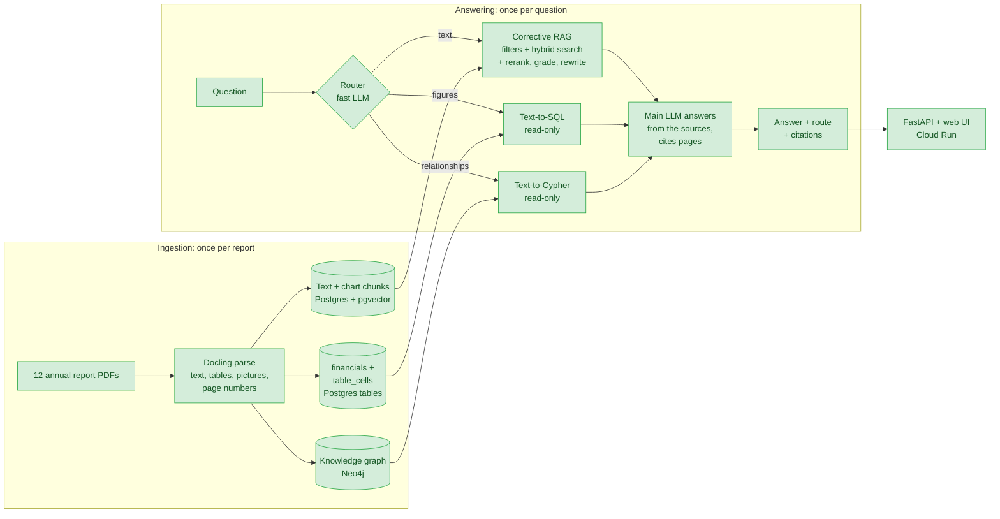
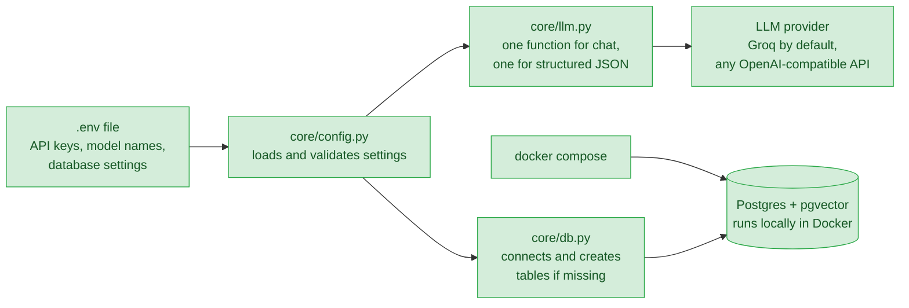
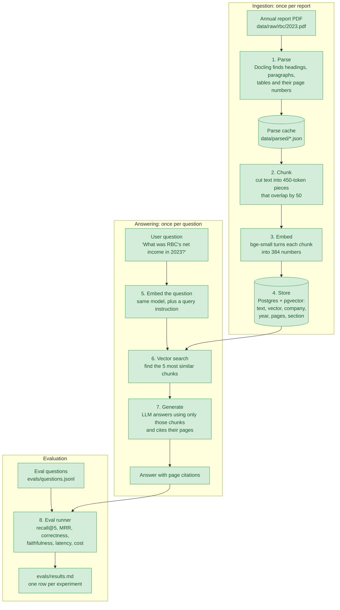
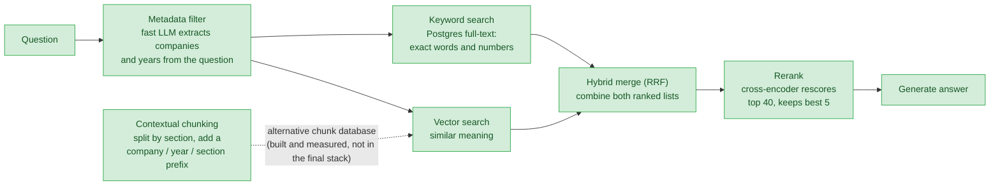
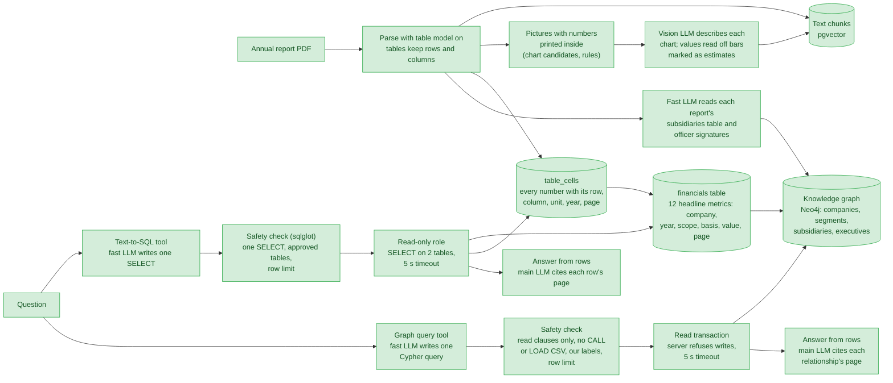
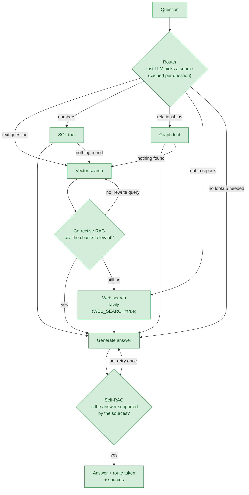
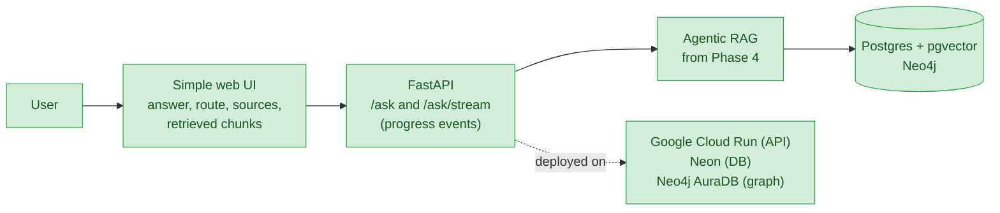

# ReportLens

Question answering over Canadian public companies' annual reports, built to demonstrate and measure 10 RAG techniques.

Ask *"Which bank had the higher CET1 ratio in 2024, RBC or Scotiabank?"* and a router sends the question to the right source (text search, a SQL table of financial figures, or a knowledge graph), which answers with page citations from the reports. Every technique is switched on one at a time and measured on a fixed set of 53 questions, so each one's effect is a number, not a claim.

- **Live demo:** https://reportlens-400767792007.us-east1.run.app (password-protected to protect the free LLM quota; ask the owner). Demo video: not recorded yet.
- **Corpus:** 12 annual reports, from RBC, Scotiabank and BCE for fiscal 2021–2024.
- **Design choices:** each one is logged with the options considered and the eval evidence in [`DECISIONS.md`](DECISIONS.md); [the main ones are summarized below](#design-decisions).

## Architecture



1. **Ingestion** parses each PDF once and fills three stores: text and chart chunks for search, tables of financial figures for SQL, and a graph of subsidiaries, segments and executives.
2. **Routing:** for each question, the fast LLM picks the source that fits. If SQL or the graph finds nothing, text search answers instead.
3. **Answering:** the main LLM answers only from what the source returned, putting a page citation after each claim, or says it couldn't find the answer.

## Headline results

All on the same 53 questions (numeric, trend, comparison, relationship, chart-only and out-of-corpus). Correctness and faithfulness are graded by an LLM judge; recall@5 and MRR check whether the expected pages were retrieved. Full history: [`evals/results.md`](evals/results.md).

| Setup (n=53) | Correctness | Faithfulness | Recall@5 | p50 latency |
|--------------|-------------|--------------|----------|-------------|
| Text search only (Phase 2 stack + corrective RAG) | 0.74 | 0.92 | 0.68 | 7.2s |
| **Router** (text, SQL or graph per question) | **0.88** | 0.93 | 0.66 | 8.3s |
| **Router + corrective RAG** (the default) | **0.89** | 0.94 | 0.69 | 11.0s |
| Router + corrective RAG + Self-RAG | 0.78 | **0.97** | 0.72 | 15.1s |

- **Most of the gain comes from the router.** Sending figures to SQL and relationship questions to the graph lifts correctness from 0.74 to 0.88.
- **Corrective RAG adds little on top** (+0.01). Once the router handles the figures, few questions are left where grading and rewriting the search matter.
- **Self-RAG made answers worse.** Its checker flagged correct arithmetic and SQL/graph facts as unsupported, and the revision then dropped them, or refused. Faithfulness went up because the answers said less. It stays off, and the reasons are [explained below](#phase-4-agentic-layer-).
- **Recall@5 is lower for routed answers** because SQL and graph answers cite table rows rather than retrieved chunks, so fewer of their pages count as retrieved. Correctness is the number to compare.

From the Phase 1 baseline (correctness 0.42 on 31 questions) to the routed stack, each phase's step is measured in [Results in detail](#results-in-detail).

## Quickstart

```bash
cp .env.example .env          # then add your free Groq API key
uv sync
docker compose up -d          # start Postgres + pgvector, and Neo4j
uv run pytest                 # fast tests (add -m slow for tests that run real models)

# Put PDFs at data/raw/{company}/{year}.pdf, then:
uv run python scripts/ingest_all.py --companies bce,rbc,scotiabank
# Contextual chunks, in their own database:
POSTGRES_DB=reportlens_contextual CHUNKING=contextual uv run python scripts/ingest_all.py --companies bce,rbc,scotiabank
# Tables kept as rows and columns (slow: ~25 min per report on a laptop CPU), in their own database:
PARSE_TABLES=true CHUNKING=tables POSTGRES_DB=reportlens_tables uv run python scripts/ingest_all.py --companies bce,rbc,scotiabank

# Load every table number into Postgres for SQL, then build the financials table (needs the table parses above; takes seconds):
uv run python scripts/load_tables.py
uv run python scripts/check_financials.py   # compare financials with the eval set's expected numbers
# Build the knowledge graph in Neo4j (two fast-LLM calls per report the first time, cached after):
uv run python scripts/load_graph.py --show

# Ask a question (from text search, or with --sql from the financial tables):
uv run python scripts/ask.py "How many wireless subscribers did Bell have in 2024?"
uv run python scripts/ask.py --sql "Which bank had the higher CET1 ratio in 2024, RBC or Scotiabank?"
```

## Project status

| Phase | What it adds | Status |
|-------|--------------|--------|
| 0. Setup | Config, LLM wrapper, database, tests | ✅ Done |
| 1. Baseline RAG + evals | Parse → chunk → embed → store; vector search; answers with citations; eval runner | ✅ Done: baseline recorded |
| 2. Better retrieval | Contextual chunking, keyword + hybrid search, reranking, metadata filters | ✅ Done: correctness 0.42 → 0.79 on the baseline's questions |
| 3. Structured data | Real tables, SQL tool, knowledge graph, chart summaries | 🟡 Built and measured: SQL tool (0.80 vs 0.67 on numeric questions), graph tool, all 384 chart candidates described; whether the chart slot is on by default is still to decide |
| 4. Agentic layer | Router, Self-RAG, Corrective RAG | 🟡 Built and measured: router 0.88, router + corrective RAG 0.89, Self-RAG 0.78 (off); multi-step questions not started |
| 5. Ship | API, UI, deployment | 🟡 API (`/ask`, `/ask/stream` with progress events) and web UI built; deployed on Cloud Run; demo video to record |

**Corpus:** 12 reports ingested, also parsed with tables: BCE, RBC and Scotiabank, fiscal 2021–2024. TD and Shopify reports are downloaded but not ingested.

## Results in detail

Every technique is measured on a fixed eval set (`evals/questions.jsonl`): 31 questions at first, 42 once paraphrased questions were added, and 53 once relationship and chart-only questions were added in Phase 3. Rows are compared only on the same questions. Full history: [`evals/results.md`](evals/results.md).

| Experiment | Questions | Recall@5 | MRR | Correctness | Faithfulness |
|------------|-----------|----------|-----|-------------|--------------|
| Phase 1 baseline: naive chunks, vector top-5 | 31 | 0.25 | 0.15 | 0.42 | 0.92 |
| + metadata filters (company, year) | 31 | 0.52 | 0.27 | 0.53 | **1.00** |
| **Phase 2 stack:** filters + hybrid search + rerank | 42 | **0.85** | **0.60** | **0.74** | **1.00** |

On the 31 questions shared with the baseline, the Phase 2 stack's correctness is **0.79**, against 0.42. The free LLM tier allows about one full run per day, so most technique-by-technique comparisons below are *retrieval only*: they score search (recall@5, MRR) without generating answers.

**Does the wording of the question matter?** Most eval questions borrowed the reports' own terms, which favours keyword search. So 11 questions were rephrased in everyday words (same facts, same pages), e.g. *"How many cellphone customers did Bell have?"* instead of *"How many mobile phone subscribers…"*. Retrieval recall@5 on those 11 facts:

| Retriever | Report's wording | Everyday wording |
|-----------|------------------|------------------|
| Vector + filters | 0.50 | 0.55 |
| Keyword + filters | **0.95** | 0.32 |

Keyword search wins when the question uses the report's exact terms and collapses when it doesn't. Vector search is steady either way. On all 42 questions, the two find different correct pages: together their top-5 lists cover 34 of 39 answerable questions, against 29 for keyword alone. That gap is what the **hybrid merge (RRF)** is meant to capture.

**Hybrid search result:** recall@5 **0.62** (MRR 0.45), more balanced across wordings (0.68 report wording, 0.50 everyday wording) but *below* keyword alone overall. RRF rewards chunks that both retrievers rank fairly well, so a so-so chunk ranked about 6th by both can push out the right page that keyword search ranked 1st. Tuning RRF changed little (0.62–0.65). Yet the right page is somewhere in the combined top-20 candidates for **all 39** answerable questions: the candidates are fine, the ordering isn't. That's the job of the next step, **reranking**.

**Reranking result:** with a cross-encoder rescoring the top 40 hybrid candidates, recall@5 rose from 0.62 to **0.85** (MRR 0.45 → 0.60) on all 42 questions, the best retrieval score of any combination.

**Contextual chunking result:** chunks that follow section boundaries and carry a label (company, year, section, pages) more than doubled vector search's recall@5, *with no filters at all*:

| Retriever (no filters) | Naive chunks | Contextual chunks |
|------------------------|--------------|-------------------|
| Vector | 0.31 | **0.71** |
| Keyword | 0.35 | 0.32 |
| Hybrid + rerank | 0.45 | **0.71** |

The label puts the company and year into every embedding, so vector search can tell RBC 2023 from RBC 2021 by itself. Keyword search doesn't change, because the label isn't in the full-text index. Citations also get more precise: about 15% of contextual chunks span more than one page, against about 65% of naive ones.

**With metadata filters, though, naive chunks come out ahead:**

| Retriever (with filters) | Naive chunks | Contextual chunks |
|--------------------------|--------------|-------------------|
| Vector | 0.50 | **0.76** |
| Keyword | 0.69 | **0.76** |
| Hybrid + rerank | **0.85** | 0.76 |

Filters already supply the company and year that the label added, so most of contextual chunking's advantage disappears. And recall is scored by page: a naive chunk often spans 2–3 pages, so five naive hits cover more pages than five shorter contextual ones. The final Phase 2 stack therefore uses naive chunks. Larger contextual chunks might close the gap; that's left as an open question rather than tuned on 42 questions.

**Table chunks result (Phase 3):** with Docling's table model on, each table becomes its own chunk with its header row, so numbers keep their row and column labels. On the same stack:

| Phase 2 stack | Recall@5 | MRR | Correctness | Faithfulness |
|---------------|----------|-----|-------------|--------------|
| Naive chunks | **0.85** | **0.60** | **0.74** | **1.00** |
| Table chunks | 0.81 | 0.55 | 0.70 | 0.92 |

Tables fixed the questions where the model had picked the wrong row (3.5 questions gained, e.g. Scotiabank's *reported* rather than *adjusted* net income), but lost about 5 elsewhere: some right pages were no longer retrieved, and in one answer the model used a quarterly column instead of the full year. Tables are 48% of chunks but only about 20% of what search retrieves. So naive chunks stay the default for text search, and the parsed tables feed the `financials` table next, where "segment vs total" and "reported vs adjusted" become explicit columns instead of something the model must infer.

**SQL tool result (Phase 3):** on the 33 numeric, trend and comparison questions, answering from the `financials` / `table_cells` tables beats text search, using a fifth of the answer-model tokens:

| Source (same 33 questions) | Correctness | Tokens per question |
|----------------------------|-------------|---------------------|
| Text search (Phase 2 stack) | 0.67 | ~2,900 |
| SQL tool | 0.79 | ~560 |
| **SQL tool + comparison rule** | **0.80** | **~500** |
| Better of text and the first SQL run, per question | 0.94 | |

SQL fixes the "right page, wrong label" answers: the bank's total instead of a segment's, reported instead of adjusted, the restated prior year. Text search still wins "why" questions and facts only in the prose (BCE's exact headcount). Picking the right one per question is the job of the Phase 4 router. The second SQL run adds one prompt rule (in comparisons, return a row per company and year instead of picking the winner in SQL), which fixed the CET1 comparison it was written for.

**Graph tool result (Phase 3):** the eval set has only two relationship questions, both about RBC's U.S. bank. The graph answered *"Which American bank does RBC own?"* (City National Bank, citing the subsidiaries table in all four reports) but not *"What is the name of RBC's U.S. commercial bank?"*: the graph knows each subsidiary's name and principal office, not what kind of business it is, so the model picked *RBC USA Holdco Corporation*. Text search gets both right.

With 7 more relationship questions (executives, ownership shares, segment changes; n=9):

| Source (same 9 questions) | Correctness | Tokens per question |
|---------------------------|-------------|---------------------|
| Text search (Phase 2 stack) | **0.83** | ~2,850 |
| Graph tool | 0.56 | ~510 |

The graph wins the one question that spans two reports (*"Who replaced Nadine Ahn as RBC's CFO?"*: text search refused). It loses where its query misses: the fast model writes different Cypher from run to run (Scotiabank's 2024 CFO and BCE's 2024 CEO/CFO came back empty in the eval but right when re-asked), sometimes leaves out the property asked about (ownership share), and declined the BCE segment question although segments are in the graph. So, like SQL for numbers, the graph is a complement for cross-year relationship questions, not a replacement; choosing per question is the Phase 4 router's job.

**Chart summaries result (Phase 3):** all 384 chart candidates were described by the vision model, and 379 were loaded as chunks (the model judged 5 not to be charts). Four eval questions can only be answered from a chart, such as *"Which market contributed the most to Scotiabank's 2024 net income?"* (a donut chart). Retrieval only, best text stack:

| How charts are searched (n=53) | Recall@5 | MRR | Chart-only questions found | p50 latency |
|--------------------------------|----------|-----|----------------------------|-------------|
| Not at all | 0.80 | 0.63 | 1 of 4 | 4.7s |
| Mixed in with text (`RETRIEVAL_FIGURES=true`) | 0.81 | 0.61 | 2 of 4 | 5.5s |
| **One reserved slot** (`RETRIEVAL_FIGURE_SLOTS=1`) | **0.85** | **0.65** | **4 of 4** | 8.4s |

Mixed in with text, charts mostly crowd out text: Scotiabank's page 17 alone has 5 charts, and they push the right text chunk down without the right chart reaching the top 5. With a reserved slot, charts are searched separately and the best one replaces the 5th text chunk, so each kind gets its own competition. The cost is one question whose only right page was that 5th text chunk, and a second rerank (about 4 s on a laptop CPU).

In the routed setup the slot barely gets a chance: the router sends two of the four chart questions ("which market contributed the most", "what share of revenues came from each segment") to SQL, which answers from segment figures that aren't the chart's numbers. On all 53 questions, router + corrective RAG + the chart slot scores 0.87 correctness (faithfulness 0.98, p50 13.0 s), against 0.89 without the slot: within run-to-run noise. The one chart question that did reach text search (RBC's AUM split, after SQL found nothing) went from wrong to right. The slot therefore stays off by default for now; routing share and breakdown questions to text search would let it help.

**Phase 4 results:** the router, corrective RAG and Self-RAG, each switched on and off on all 53 questions (the [headline table](#headline-results) above):

- **Router:** picks SQL for figures, the graph for relationships across years, and text search for the rest. Correctness rises from 0.74 (text search only) to 0.88, because each question goes to the source that answered that kind best in Phase 3.
- **Corrective RAG:** on its own it scores 0.74 on 53 questions, the same score the plain Phase 2 stack had on 42. On top of the router it adds 0.01 and about 3 s per question: by then SQL and the graph handle most questions where plain search went wrong.
- **Self-RAG:** 0.78, against 0.89 without it. Comparing the two runs question by question, 8 answers got worse, and in nearly every case the checker had called a correct claim unsupported:
  - **Arithmetic:** "up $4,613 million (40%)" isn't printed in any source; it's computed from two figures that are. The revision removed it, and 5 answers dropped to partly correct for leaving out the "how much".
  - **Facts from SQL and graph rows:** "RBC 13.2%, Scotiabank 13.1%" or "Scotiabank's CFO was Raj Viswanathan" were flagged too. The revision then gave up, and 3 correct answers became refusals.

  Likely fixes: tell the checker that arithmetic on cited figures counts as supported, skip the check for SQL and graph answers, and never let a revision turn an answer into a refusal.
- **Run-to-run noise:** the same setup can score about ±0.02 differently, because the LLMs and the judge don't answer identically every time. Differences smaller than that aren't read as real.

**Where the Phase 2 stack still fails** (10 of 42 questions wrong, 2 partly right): mostly numbers whose right page *was* retrieved but whose label got lost, such as an *adjusted* figure reported instead of the *reported* one (Phase 3: tables), and comparisons that need two reports at once (Phase 4: agentic layer).

What the baseline shows, and which phase targets each problem:

- **Retrieval is the bottleneck.** In 14 of 28 answerable questions, the right pages weren't retrieved and the model refused. The model rarely makes things up (faithfulness 0.92), so better retrieval should turn straight into better answers.
- **The wrong year is retrieved.** 55% of retrieved chunks came from a different fiscal year than the question asks about, because similar reports from different years look alike to vector search. *Phase 2 metadata filters: now 14%, and recall doubled.*
- **Numbers lose their labels.** Without the table model, a figure can end up far from its row label, so the model may pick the wrong row (q001 reported the *adjusted* figure). *Phase 3 tables.*
- **Multi-report questions fail.** Comparison questions score 0: one top-5 search can't cover two reports at once. *Phase 4 agentic layer.*
- **Out-of-corpus questions are handled.** All 3 were correctly refused.

## Design decisions

The main choices, each with its alternatives and evidence in [`DECISIONS.md`](DECISIONS.md):

| Decision | Why |
|----------|-----|
| **Free LLMs through one OpenAI-compatible wrapper** (`core/llm.py`, Groq) | Every call is logged with tokens and time in one place, and switching provider only means editing `.env`. The free tier's ~200k tokens per model per day shaped much of the rest: caches everywhere, and evals that resume across days. |
| **Naive 450-token chunks stay the default** over contextual and table chunks | With metadata filters, naive chunks gave the best recall (0.85 vs 0.76 contextual, 0.81 tables). Contextual labels mostly add the company and year, which the filters already supply. |
| **Hybrid search + cross-encoder rerank** | Keyword search wins on the reports' exact terms and fails on everyday wording; vector search is steady either way. RRF alone ordered the candidates poorly (recall 0.62); reranking the top 40 fixed it (0.85). |
| **Company/year filters only, with fallback** | No failing question was caused by a wrong section, so there's no section filter. A filter that matches nothing falls back to an unfiltered search, so a bad filter is never worse than none. |
| **Numbers from tables by rules and a vote, not an LLM** | 110,335 table cells parsed in seconds. The same figure appears in several tables, so the most common value wins, and how many cells agree is kept as a confidence signal. |
| **LLM-written SQL and Cypher are untrusted** | SQL: parsed and checked with sqlglot, run as a read-only role, with a timeout and a row limit. Cypher: a text check for read-only clauses and known labels, then a read transaction. |
| **One fast-LLM router call per question; text search as default and fallback** | Route accuracy 0.83 vs 0.71 for always using text search. A source that finds nothing or fails hands the question to text search. |
| **Self-RAG kept but off** | It lowered correctness from 0.89 to 0.78 by flagging correct arithmetic and SQL/graph facts. Kept as a measured negative result, with the likely fixes noted. |
| **Charts in a reserved slot, off for now** | Mixed in with text, charts crowded it out (recall 0.81); a reserved slot found all 4 chart-only questions (0.85). The router still sends most chart questions to SQL. |
| **Progress events instead of token streaming** | Citations are parsed and answers checked only once complete, so streaming tokens would show unchecked text. The UI shows the route and each step as they happen. |
| **Cloud Run + Neon + AuraDB, behind a demo password and a daily cap** | It scales to zero and fits the free tiers. The daily question cap is stored in Postgres, so it survives the instance stopping. |

## How it works, phase by phase

How to read the diagrams:

- **Green boxes with solid borders** are built and working.
- **Grey boxes with dashed borders** are planned and not built yet.
- **Arrows** show data moving from one step to the next.

### Phase 0: Setup ✅

The foundation every later phase uses: one place for settings, one place for LLM calls, and a database.



1. **`.env`** holds everything that changes between machines: API keys, model names, database port. It's never committed.
2. **`core/config.py`** reads `.env` once and checks that every value is valid. Code never hardcodes a model name or path.
3. **`core/llm.py`** is the only way the code talks to an LLM, so every call's cost and speed is logged in one place. Switching between Groq, Gemini and Ollama only means editing `.env`.
4. **`core/db.py`** connects to Postgres and creates the tables if they don't exist yet.
5. **Postgres with pgvector** stores text and vectors (lists of numbers that capture meaning) side by side.

### Phase 1: Baseline RAG + evals ✅

The simplest complete RAG system, used as the baseline every later technique is measured against. It has two halves: **ingestion** (done once per report) and **answering** (done for every question).



1. **Parse** (`ingest/parse.py`): Docling reads the PDF's layout and returns blocks of text, each tagged with its page number and the heading it sits under. Page headers and footers are dropped. The result is cached, so each PDF is parsed only once (about 6–7 minutes per report on a laptop CPU).
2. **Chunk** (`ingest/chunking.py`): the report's text is cut into equal 450-token pieces, ignoring headings on purpose. That's what makes this the "naive" baseline. Each chunk remembers every page it came from, for citations.
3. **Embed** (`ingest/embed.py`): a small embedding model turns each chunk into a vector, so that chunks with similar meaning get similar vectors.
4. **Store** (`ingest/load.py`): chunks, vectors and metadata go into Postgres. A report that hasn't changed is skipped, so re-running is fast.
5. **Embed the question** (`ingest/embed.py`): the question becomes a vector with the same model, plus the short instruction bge expects in front of questions.
6. **Vector search** (`retrieval/vector.py`): Postgres finds the 5 chunks whose vectors are closest to the question's, using an HNSW index (a fast nearest-neighbour index). A search takes well under a second.
7. **Generate** (`generation/answer.py`): the LLM gets the 5 chunks as numbered sources and must answer from them only, putting a marker like `[2]` after each claim. The code turns those markers into citations (company, year, pages) and drops any that point to a source that doesn't exist. If the sources don't contain the answer, the LLM replies with a fixed "couldn't find this" sentence instead of guessing.
8. **Evaluate** (`evals/run_evals.py`): every question in a fixed set is answered and scored. Recall@5 and MRR check, without any LLM, whether retrieval found the expected pages. An LLM judge grades correctness against the expected answer, and checks faithfulness (is every claim backed by the retrieved chunks?). Latency and cost are recorded too. Each run's details are saved in `evals/runs/`, and a summary row goes into `evals/results.md`, so every later change can be compared against this baseline.

### Phase 2: Better retrieval ✅

Improves step 6 above. Each technique is added one at a time, with an eval run after each, so its effect can be measured on its own.



- **Contextual chunking** (`ingest/chunking.py`, `CHUNKING=contextual`): a new chunk starts at a heading, once the current chunk has at least 100 tokens, so the many small table titles don't create tiny chunks. Paragraphs are never cut, and oversized tables are split between rows. Each chunk gets a short label, such as `RBC 2023 annual report | Section: Net income | Page 26`. The label is embedded with the text and read by the reranker, so a chunk still makes sense on its own. The plan also called for an LLM-written one-line summary per chunk, but that would take about 3–4 million tokens (roughly 18 days of the free tier), so the label uses metadata only. Contextual chunks live in their own database (`POSTGRES_DB=reportlens_contextual`), so the two strategies can be compared without re-embedding.
- **Metadata filter** (`retrieval/filters.py`): the fast LLM reads which companies and fiscal years the question names, so "RBC's 2023 net income" only searches RBC's 2023 report. It knows nicknames like Bell → BCE and expands ranges like "2022 to 2024". Values are checked against the database, and if a filter matches nothing, the search runs unfiltered, so a bad filter is never worse than none. Extracted filters are cached in `data/cache/filters.json`, so a repeated question (as in every eval run) costs no LLM call and always gets the same filters. Turn it on with `RETRIEVAL_USE_FILTERS=true`. There's no section filter: no failing question was caused by a wrong section, so it wasn't worth the added complexity.
- **Keyword search** (`retrieval/keyword.py`): Postgres full-text search finds chunks containing the question's words, after stemming ("incomes" → "incom") and dropping common words like "what". Any word can match, and chunks with more matching words close together rank higher. It catches exact terms that vector search blurs, like "CET1" or "attributable to equity holders". Ranking uses `ts_rank_cd`, which is BM25-like but **not true BM25**: it doesn't weight rare words above common ones across the whole collection. Use it with `RETRIEVAL_MODE=keyword`.
- **Hybrid merge (RRF)** (`retrieval/hybrid.py`): takes the top 20 from vector search and the top 20 from keyword search, and scores each chunk by adding `1 / (60 + rank)` for every list it appears in. Only the ranks count, not the raw scores, which are on different scales. Chunks both retrievers like rise to the top. Use it with `RETRIEVAL_MODE=hybrid`.
- **Rerank** (`retrieval/rerank.py`): the retriever fetches 40 candidates, and a cross-encoder (`ms-marco-MiniLM-L-6-v2`) reads the question and each candidate *together* and scores how well the candidate answers it. The best 5 are kept. That's slower (about 3 s per question on a laptop CPU) but much more accurate than the retrievers, which look at the question and chunks separately. Turn it on with `RETRIEVAL_RERANK=true`; it works on top of any retrieval mode.

### Phase 3: Structured data 🟡

Many questions are about numbers in tables, which plain text search handles poorly. This phase adds two structured sources next to the vector search.



- **Tables with structure** (`PARSE_TABLES=true`, `CHUNKING=tables`): Docling's table model is turned on, so each number keeps its row and column labels. Each table becomes its own chunk, starting with its section heading and header row; a table too big for one chunk is split between rows and every piece repeats the header. The table model crashes at random on this laptop's CPU, so each report is converted in 20-page slices, each in a fresh process with a timeout and up to 3 attempts (about 35–45 min per report). Table chunks live in their own database (`reportlens_tables`); measured above, they aren't the default.
- **Chart summaries** (`ingest/figures.py`, `scripts/describe_figures.py`): Docling marks pictures but drops the text inside them, so charts were invisible to search. Most charts here are vector graphics whose labels and values are real text in the PDF, so a rule finds the candidates for free: pictures with at least 4 numbers printed inside (384 of ~1,170 pictures; photos and logos have none). Each is cropped from the PDF and sent, with its printed text and the heading above it (often the chart's title and unit), to a vision model (`LLM_MODEL_VISION`, Qwen on Groq), which returns a title, a one-line summary and the data points. A value read off a bar's height is marked *estimated from the chart*, because such readings are rough (one test read 98,000 for a bar at about 110,000). Each chart becomes one chunk (`kind = 'figure'`); summaries are cached, so the script can stop at the daily limit and resume. BCE's 2022 report prints its charts as images without a text layer, so the rule misses them.
- **Searching charts** (`retrieval/search.py`): chart chunks are left out of search by default. `RETRIEVAL_FIGURES=true` mixes them in with text. `RETRIEVAL_FIGURE_SLOTS=1` instead runs the same search (filters, hybrid, rerank) twice, once over text and once over charts, keeps the best chart if it's from a report the filters allow, gives it the 5th place, and orders the five by reranker score (both lists were scored by the same cross-encoder against the same question, so the scores compare). Measured above: the reserved slot finds all 4 chart-only questions.
- **`table_cells`** (`ingest/tables.py`, `scripts/load_tables.py`): every number in every parsed table becomes one row, labelled with its row, its column header, its unit (millions, percent, dollars per share…), the year and kind of period it covers (full year, quarter, % change) and its page. Rules only, no LLM: 110,335 cells from 12 reports in seconds. Rows like "Reported Results" and "Adjusted Results" that head the rows below them are kept as a `row_group`, so the *reported* and *adjusted* net income no longer look alike. Footnote markers are stripped from labels, and when Docling takes a title row as the header, the real header row below it is merged in.
- **`financials` table** (`ingest/financials.py`, metrics defined in `ingest/metrics.py`): 12 headline metrics (net income, EPS, CET1 ratio, revenue, capex, employees…), one row per company, year, report, **scope** (whole company or a segment such as *Canadian Banking*) and **basis** (reported or adjusted). The same figure is printed in several tables, so every matching cell votes and the most common value wins; the number of agreeing cells is kept as a confidence signal. Figures are kept per report because later reports sometimes restate the prior year. Checked against the eval set with `scripts/check_financials.py`: 29 of the 33 numeric questions' figures are in the table (the other 4 are a percentage change and a headcount printed only in the text).
- **Text-to-SQL** (`sources/sql_tool.py`, `sources/sql_safety.py`; try it with `scripts/ask.py --sql "..."`): the fast LLM is told the two tables' columns, the 12 metrics and each company's segments, and writes one SELECT. Because LLM-written SQL is untrusted, there are three layers of protection: (1) the SQL is parsed with `sqlglot` and rejected unless it's a single SELECT on `financials`/`table_cells` with no risky functions, and a 50-row limit is added; (2) it runs as `reportlens_reader`, a Postgres role that can only SELECT those two tables, with a 5-second timeout; (3) the session itself is read-only and rolled back after each query. If the SQL is rejected or fails, the error goes back to the LLM for one more try. The main LLM then answers from the rows and cites each row's page. Example: *"What was Scotiabank's net income attributable to equity holders in fiscal 2023?"* → `... WHERE metric = 'net_income_to_shareholders' AND scope = 'total' AND basis = 'reported'` → "$7,410 million [page 22]".
- **Knowledge graph** (`ingest/graph.py`, `ingest/graph_names.py`, `ingest/graph_load.py`, `scripts/load_graph.py`): Neo4j holds who owns what and who runs what, for questions like *"Which American bank does RBC own?"* or *"Who was Scotiabank's CFO in 2024?"*.
  - `(Company)-[:HAS_SEGMENT]->(Segment)` comes straight from `financials` (no LLM), so it shows BCE replacing Wireless and Wireline with Bell CTS in 2023.
  - `(Company)-[:OWNS]->(Subsidiary)`: the fast LLM reads each report's subsidiaries table, 15 rows at a time. An LLM is needed because RBC prints a holding company and everything it owns in one cell. Ownership shares are kept when printed (Scotiabank Chile: 83.03% in 2021, 99.79% after the 2022 buyout).
  - `(Executive)-[:HOLDS_ROLE]->(Company)`: the fast LLM reads only short passages that contain an officer title, such as the signatures under management's report. A name that no passage contains is thrown away, so the LLM can't invent an executive.
  - Every relationship stores the report year and page, so graph answers can cite pages too, and changes over time are visible (RBC's CFO: Nadine Ahn → Katherine Gibson in 2024).
  - Names are matched loosely ("David I. McKay" = "David McKay", "Scotiabank& Trust" = "Scotiabank & Trust"), and LLM output is cached, so rebuilding the graph is free.
- **Graph query tool** (`sources/graph_tool.py`, `sources/cypher_safety.py`; try it with `scripts/ask.py --graph "..."`): the same steps as the SQL tool. The fast LLM is told the graph's labels, relationships and company ids and writes one Cypher query, which must return each relationship's company, report year and page so the answer can cite it. Neo4j Community has no read-only users, so there are two layers of protection: (1) a check on the query's text (with strings and comments blanked out first) allows only read clauses, rejects `CALL` (procedures), `LOAD CSV` (reads files and URLs), `USE` (other databases) and `apoc.*`/`dbms.*` functions, allows only the graph's 4 labels and 3 relationship types, and adds a 50-row limit; (2) the query runs in a read transaction, which the server refuses to write in, with a 5-second timeout, and only the first 50 rows are fetched. A rejected or failing query goes back to the LLM with the reason. Example: *"How did RBC's CFO change over the years?"* → `MATCH (e:Executive)-[r:HOLDS_ROLE]->(c:Company {id:'rbc'}) WHERE r.role = 'cfo' ...` → "Nadine Ahn in 2021 [1], 2022 [2] and 2023 [3]. In 2024 the CFO changed to Katherine Gibson [4]."

### Phase 4: Agentic layer 🟡

A router decides which source fits each question, and two self-checking loops catch weak retrieval and unsupported answers.



- **Router** (`agents/router.py`, `agents/routed.py`; try it with `scripts/ask.py --routed "..."`): the fast LLM picks one source with a one-line reason, from a short description of what each source is good at, taken from the Phase 3 evals (SQL for figures, trends and comparisons; the graph for officer, subsidiary and segment changes across years; text search for everything else and as the default; web for anything the reports don't cover; no lookup only to define a finance term). If SQL or the graph finds nothing, text search answers instead, and the answer reports the path taken (e.g. `sql -> vector`). If the router call itself fails, the question goes to text search. If a tool fails (a network or database error), text search answers too.
  - **Route accuracy** (`evals/route_accuracy.py`, fast-model calls only): on the 42 questions that already have scores from two or more sources, the router picks a best-scoring source for **35 (0.83)**, against 30 for always using text search and 28 for always using SQL. Its misses: BCE's exact headcount (only in the text, but it looks like a SQL figure), two relationship questions sent to the graph or SQL that text search answered, and the CFO-change question, which it sent to text search instead of the graph.
- **Web search** (`sources/web_tool.py`): with `WEB_SEARCH=true` and a `TAVILY_API_KEY`, the router's web route asks Tavily for the top 5 results, and the main LLM answers only from them, cites each URL, and starts with *"From the web, not the annual reports:"*. Off by default: the evals count an out-of-corpus question as correct only when it is refused, so with web search off that route goes to text search, which refuses it. Web pages are untrusted text, so the prompt tells the model to ignore any instructions inside them. One JSON POST, so it uses Python's standard library instead of another package.
- **Corrective RAG** (`agents/corrective.py`, a LangGraph state graph; try it with `scripts/ask.py --corrective "..."`): before answering from text search, the fast model grades the chunks. The router's text-search route (and its fallback when SQL or the graph finds nothing) runs through it; `ROUTED_CORRECTIVE=false` switches back to plain search for comparison. Measured: 0.89 with the router against 0.88 without it (results above).

  ```mermaid
  flowchart TD
      q["Question"] --> retrieve["retrieve<br/>text search: filters + hybrid + rerank, top 5"]
      retrieve --> grade{"grade<br/>fast LLM: which chunks are relevant?<br/>are they enough to answer?"}
      grade -->|"enough"| gen["generate<br/>main LLM answers from the<br/>relevant chunks only, with pages"]
      grade -->|"not enough, no rewrite yet"| rewrite["rewrite<br/>fast LLM turns the question into a<br/>search query aimed at what's missing"]
      rewrite --> retrieve
      grade -->|"still not enough,<br/>some relevant"| gen
      grade -->|"nothing relevant"| fallback{"fallback"}
      fallback -->|"WEB_SEARCH=true"| web["Web search (Tavily)"]
      fallback -->|"off (default)"| refuse["I couldn't find this<br/>in the annual reports."]
      gen --> out["Answer + steps taken"]
      web --> out
      refuse --> out
  ```

  - **One grading call per search**, not one per chunk: the five chunks go to the fast model together, which keeps a question within the free tier's 8,000 tokens per minute. Grades and rewrites are cached, like the router's picks.
  - **Relevant chunks are kept across rounds**, so a rewrite adds what was missing (e.g. the second company in a comparison) instead of replacing what was already found.
  - **The answer model sees only relevant chunks.** That is the "corrective" part: a chunk about a different year or one business segment can't be mistaken for the answer.
  - **Fails open:** if grading fails, every chunk is kept; if rewriting fails, the same query is searched again. Each node's work is recorded, so the answer shows its path, e.g. `retrieve (5) -> grade 0/5 relevant -> rewrite: ... -> retrieve (5) -> grade 2/5 relevant, enough -> generate`.
  - **Step limit:** LangGraph stops a run after `AGENT_MAX_STEPS` (12; a normal run takes at most 6), and the question gets the refusal instead of looping.
- **Self-RAG** (`agents/self_rag.py`, a second LangGraph graph; off by default because it lowered correctness from 0.89 to 0.78, see results above; try it with `SELF_RAG=true scripts/ask.py --routed "..."`): after any source answers, the fast model reads the answer and the sources it was written from (text chunks, or SQL and graph rows) and lists the facts no cited source states. If there are any, the main model rewrites the answer from the same sources, told which claims to fix or drop, and the new answer is checked again.

  ```mermaid
  flowchart LR
      a["Answer from the router<br/>(text, SQL, graph or web)"] --> skip{"has sources?"}
      skip -->|"no: refusal or<br/>no-lookup answer"| out["Answer"]
      skip -->|"yes"| check{"check<br/>fast LLM: does every cited<br/>source state its sentence's fact?"}
      check -->|"supported"| out
      check -->|"unsupported claims,<br/>no revision yet"| revise["revise<br/>main LLM rewrites from the<br/>same sources, fixing those claims"]
      revise --> check
      check -->|"still unsupported"| marked["Answer, marked unsupported"]
  ```

  - **"Is retrieval needed?"** is the router's `none` route, which answers finance-term questions without a lookup; a second call deciding the same thing would add cost and nothing else.
  - **One revision at most** (`SELF_RAG_MAX_REVISIONS=1`). An answer that still fails is returned marked unsupported rather than refused, because the checker can be wrong too.
  - **Its own prompt, not the eval judge's:** the check follows each sentence's citations, while the eval's faithfulness judge splits the whole answer into claims. Both use the fast model, so a gain in faithfulness is read with care; correctness and the revision rate matter more.
- **Safety limits:** corrective RAG stops after `AGENT_MAX_STEPS` and refuses rather than loop; a source that raises an error falls back to text search; grading and rewriting fail open (keep every chunk, search the same query again). A rate-limit error is never failed open: it stops the question, so an eval run can't record a quota error as a wrong answer.
- **Not built yet: multi-step questions,** such as a comparison that needs a figure from SQL and an explanation from the text. Each question currently goes to one source.

### Phase 5: Ship 🟡

Makes the system usable by someone other than the developer.



- **API** (`api/main.py`, `api/service.py`, `api/schemas.py`; start it with `uv run uvicorn reportlens.api.main:app --reload`, docs at `http://localhost:8000/docs`):

  | Endpoint | What it does |
  |----------|--------------|
  | `GET /health` | Postgres and Neo4j reachable? Web search and Self-RAG on? |
  | `GET /meta` | Companies and years loaded, and the sources a question can ask for |
  | `POST /ask` | `{"question": "...", "source": "auto"}` → the answer with the route, steps, citations (company, year, pages, or URL), every chunk the answer model saw, tokens and latency. `source` is `auto` (the router), `text`, `corrective`, `sql` or `graph` (SQL and graph answers include their query) |
  | `POST /ask/stream` | The same, as server-sent events |

  ```mermaid
  sequenceDiagram
      participant C as Client
      participant A as FastAPI
      participant W as Worker thread
      C->>A: POST /ask/stream {question}
      A->>W: answer the question
      W-->>C: event: route (the router's pick, after ~1 s)
      W-->>C: event: step (each corrective RAG / Self-RAG step)
      W-->>C: event: answer (the full response, as /ask returns it)
      W-->>C: event: done (or event: error with status 429/503/500)
  ```

  ```bash
  curl -N -X POST localhost:8000/ask/stream -H 'content-type: application/json' \
       -d '{"question": "How did RBC'"'"'s and Scotiabank'"'"'s dividends per share compare in 2024?"}'
  ```

  - **The stream reports progress, not tokens.** Citations are parsed and the answer is checked only when it is complete, and a question takes 20–60 s on a laptop CPU, so the useful part is seeing the route and each step as they happen. The agents report steps through `agents/events.py`, which does nothing unless the API is listening, so the CLI and the evals are unchanged.
  - **Resources:** a small Postgres connection pool (a connection can't be shared between requests running in parallel), one Neo4j driver (if Neo4j is down, graph routes fall back to text search and `source=graph` returns 503), and the embedding and reranking models loaded at startup.
  - **Errors:** an empty or over-500-character question → 422; out of LLM quota → 429 (saying daily or per-minute); any other error → 500 with a short message, details in the server log only. Deployed, a demo password and rate limits guard the question endpoints (below).
- **UI** (`api/static/index.html`, served at `http://localhost:8000/` by the API): one page of plain HTML, CSS and JavaScript, no build step. Ask a question (or click an example), pick a source (`auto` lets the router choose), and watch each step arrive: the router's pick and reason, corrective RAG's grades and rewrites, Self-RAG's checks. Then the answer with badges (answered or not found, route, supported by its sources, tokens, time in LLM calls), its `[n]` markers linked to the chunks they cite, a card per cited source (company, year and pages, or the URL), the SQL or Cypher behind a SQL or graph answer, and every chunk the answer model saw, with its score and the cited ones in bold, so you can see why it answered the way it did.
  - A "What is this?" panel (collapsed until opened) explains the app: the corpus, how a question is answered, and the techniques inside (Self-RAG shown as on or off from `/health`).
  - While it answers, a pipeline strip (route → search → grade → answer → check) lights up stage by stage from the stream's events, steps slide in with a timer, and a note explains the 30–60 s wait when the server was asleep. Animations are off for visitors who prefer reduced motion.
  - It reads the stream with `fetch()`, because `EventSource` only makes GET requests and `/ask/stream` is a POST.
  - Answers and chunks (web pages above all) are inserted as text, never as HTML.
  - Light and dark mode follow the system; the layout fits a phone.
- **Deploy** (live at https://reportlens-400767792007.us-east1.run.app; ask the owner for the demo password): the API + UI on **Google Cloud Run** (2 GB, scales to zero when idle, so the first question after a quiet spell waits ~30–60 s while the models load; within Cloud Run's monthly free allowance at demo traffic), Postgres on **Neon** and the graph on **Neo4j AuraDB Free**. (A Hugging Face Docker Space was the first plan; it now needs a PRO subscription.)

  ```mermaid
  flowchart LR
      local[("Local Postgres<br/>+ Neo4j")] -->|"scripts/deploy_data.py<br/>pg_dump → psql; load_graph.py<br/>(no re-parsing, no LLM calls)"| hosted[("Neon Postgres<br/>AuraDB Neo4j")]
      code["src/ + locked runtime deps<br/>(no PDF parsing, CPU-only torch)"] -->|"scripts/deploy_cloudrun.py<br/>Cloud Build makes the image"| space["Cloud Run<br/>Docker: models baked in,<br/>uvicorn on port 7860,<br/>secrets from Secret Manager"]
      space --> hosted
      space --> groq["Groq API"]
      visitor["Visitor"] -->|"demo password,<br/>10 questions/hour,<br/>100/day for everyone"| space
  ```

  - **Protecting the free-tier quota:** with `DEMO_PASSWORD` set, `/ask` needs it (the UI asks for it once per tab); each visitor gets `RATE_LIMIT_PER_HOUR` questions per rolling hour and everyone together `DAILY_QUESTION_CAP` per day (`api/access.py`). A wrong password is rejected before it counts. The hourly counts are in memory (Cloud Run runs at most one instance); the daily count is a row per day in Postgres (`demo_usage`), so an instance stopping when idle doesn't reset it. The daily cap is the hard limit, since a visitor's IP comes from a header that can be faked.
  - **A smaller image:** PDF parsing (Docling) is a separate `ingest` dependency group that local `uv sync` installs and the image leaves out, and the image uses the CPU-only build of PyTorch (no CUDA packages). Both models are downloaded when the image is built, so a cold start doesn't fetch them.
  - **Settings:** hosted databases are given as full URLs (`DATABASE_URL`, `NEO4J_URI`); the SQL tool's read-only URL is derived from `DATABASE_URL` with the reader's name and password. Deploy values live in `.env.deploy` (git-ignored; template in `deploy/env.deploy.example`); keys and passwords reach Cloud Run through Secret Manager, never a command line.
