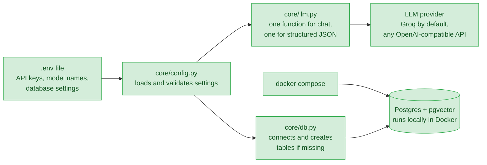
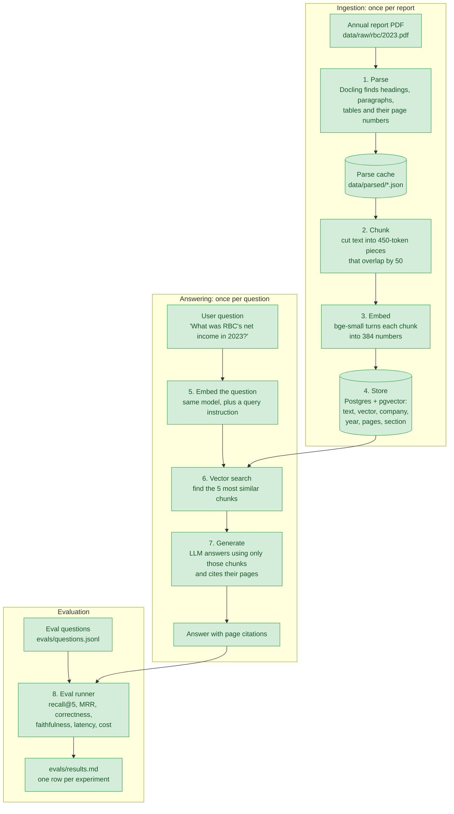
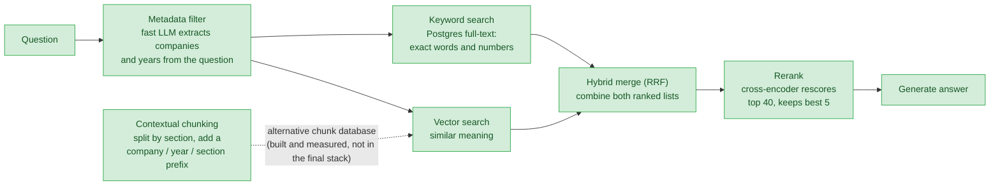
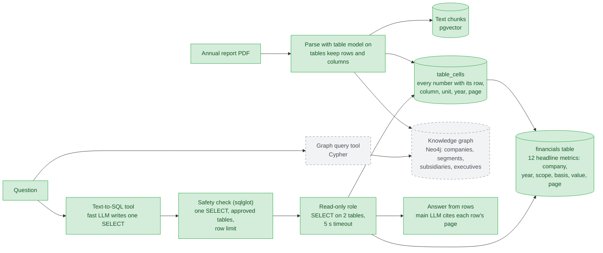
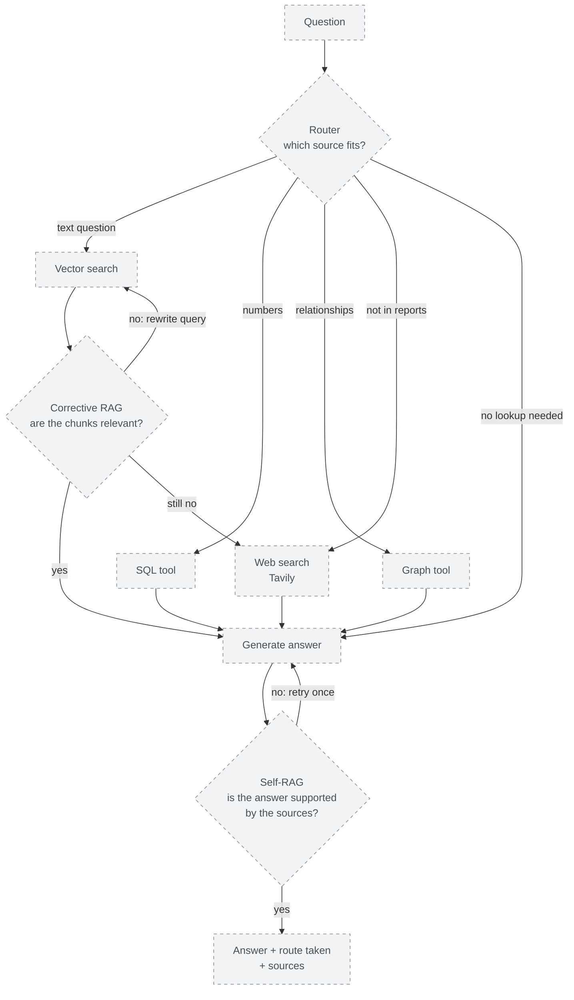
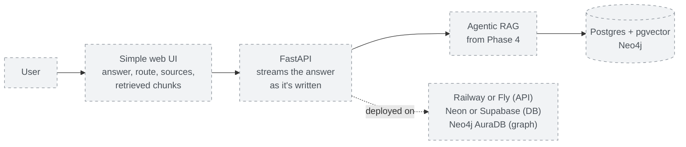

# ReportLens

Question answering over Canadian public companies' annual reports, built to demonstrate and measure 10 RAG techniques.

> Work in progress. See `CLAUDE.md` for the phase plan and `DECISIONS.md` for design choices.

## Quickstart

```bash
cp .env.example .env          # then add your free Groq API key
uv sync
docker compose up -d          # start Postgres + pgvector
uv run pytest                 # fast tests (add -m slow for tests that run real models)

# Put PDFs at data/raw/{company}/{year}.pdf, then:
uv run python scripts/ingest_all.py --companies bce,rbc,scotiabank
# Contextual chunks, in their own database:
POSTGRES_DB=reportlens_contextual CHUNKING=contextual uv run python scripts/ingest_all.py --companies bce,rbc,scotiabank
# Tables kept as rows and columns (slow: ~25 min per report on a laptop CPU), in their own database:
PARSE_TABLES=true CHUNKING=tables POSTGRES_DB=reportlens_tables uv run python scripts/ingest_all.py --companies bce,rbc,scotiabank

# Load every table number into Postgres for SQL, then build the financials table (needs the table parses above; takes seconds):
uv run python scripts/load_tables.py
uv run python scripts/check_financials.py   # compare financials with the eval set's expected numbers

# Ask a question (from text search, or with --sql from the financial tables):
uv run python scripts/ask.py "How many wireless subscribers did Bell have in 2024?"
uv run python scripts/ask.py --sql "Which bank had the higher CET1 ratio in 2024, RBC or Scotiabank?"
```

## Project status

| Phase | What it adds | Status |
|-------|--------------|--------|
| 0. Setup | Config, LLM wrapper, database, tests | ✅ Done |
| 1. Baseline RAG + evals | Parse → chunk → embed → store; vector search; answers with citations; eval runner | ✅ Done: baseline recorded |
| 2. Better retrieval | Contextual chunking, keyword + hybrid search, reranking, metadata filters | ✅ Done: correctness 0.42 → 0.79 on the baseline's questions |
| 3. Structured data | Real tables, SQL tool, knowledge graph | 🟡 In progress: SQL tool built and measured (0.80 vs 0.67 on numeric questions); graph next |
| 4. Agentic layer | Router, Self-RAG, Corrective RAG | ⬜ Planned |
| 5. Ship | API, UI, deployment | ⬜ Planned |

**Corpus so far:** 12 of 20 reports ingested (also parsed with tables) (BCE, RBC and Scotiabank, fiscal 2021–2024). TD and Shopify are downloaded but not yet ingested.

## Results so far

Every technique is measured on a fixed eval set (`evals/questions.jsonl`): 31 questions at first, 42 once paraphrased questions were added. Full history: [`evals/results.md`](evals/results.md).

| Experiment | Questions | Recall@5 | MRR | Correctness | Faithfulness |
|------------|-----------|----------|-----|-------------|--------------|
| Phase 1 baseline: naive chunks, vector top-5 | 31 | 0.25 | 0.15 | 0.42 | 0.92 |
| + metadata filters (company, year) | 31 | 0.52 | 0.27 | 0.53 | **1.00** |
| **Phase 2 stack:** filters + hybrid search + rerank | 42 | **0.85** | **0.60** | **0.74** | **1.00** |

On the 31 questions shared with the baseline, the Phase 2 stack's correctness is **0.79**, against 0.42. The free LLM tier allows about one full run per day, so most technique-by-technique comparisons below are *retrieval only*: they score search (recall@5, MRR) without generating answers.

**Does the wording of the question matter?** Most eval questions borrowed the reports' own terms, which favours keyword search. So 11 questions were rephrased in everyday words (same facts, same pages), e.g. *"How many cellphone customers did Bell have?"* instead of *"How many mobile phone subscribers…"*. Retrieval recall@5 on those 11 facts:

| Retriever | Report's wording | Everyday wording |
|-----------|------------------|------------------|
| Vector + filters | 0.50 | 0.55 |
| Keyword + filters | **0.95** | 0.32 |

Keyword search wins when the question uses the report's exact terms and collapses when it doesn't. Vector search is steady either way. On all 42 questions, the two find different correct pages: together their top-5 lists cover 34 of 39 answerable questions, against 29 for keyword alone. That gap is what the **hybrid merge (RRF)** is meant to capture.

**Hybrid search result:** recall@5 **0.62** (MRR 0.45), more balanced across wordings (0.68 report wording, 0.50 everyday wording) but *below* keyword alone overall. RRF rewards chunks that both retrievers rank fairly well, so a so-so chunk ranked about 6th by both can push out the right page that keyword search ranked 1st. Tuning RRF changed little (0.62–0.65). Yet the right page is somewhere in the combined top-20 candidates for **all 39** answerable questions: the candidates are fine, the ordering isn't. That's the job of the next step, **reranking**.

**Reranking result:** with a cross-encoder rescoring the top 40 hybrid candidates, recall@5 rose from 0.62 to **0.85** (MRR 0.45 → 0.60) on all 42 questions, the best retrieval score of any combination.

**Contextual chunking result:** chunks that follow section boundaries and carry a label (company, year, section, pages) more than doubled vector search's recall@5, *with no filters at all*:

| Retriever (no filters) | Naive chunks | Contextual chunks |
|------------------------|--------------|-------------------|
| Vector | 0.31 | **0.71** |
| Keyword | 0.35 | 0.32 |
| Hybrid + rerank | 0.45 | **0.71** |

The label puts the company and year into every embedding, so vector search can tell RBC 2023 from RBC 2021 by itself. Keyword search doesn't change, because the label isn't in the full-text index. Citations also get more precise: about 15% of contextual chunks span more than one page, against about 65% of naive ones.

**With metadata filters, though, naive chunks come out ahead:**

| Retriever (with filters) | Naive chunks | Contextual chunks |
|--------------------------|--------------|-------------------|
| Vector | 0.50 | **0.76** |
| Keyword | 0.69 | **0.76** |
| Hybrid + rerank | **0.85** | 0.76 |

Filters already supply the company and year that the label added, so most of contextual chunking's advantage disappears. And recall is scored by page: a naive chunk often spans 2–3 pages, so five naive hits cover more pages than five shorter contextual ones. The final Phase 2 stack therefore uses naive chunks. Larger contextual chunks might close the gap; that's left as an open question rather than tuned on 42 questions.

**Table chunks result (Phase 3):** with Docling's table model on, each table becomes its own chunk with its header row, so numbers keep their row and column labels. On the same stack:

| Phase 2 stack | Recall@5 | MRR | Correctness | Faithfulness |
|---------------|----------|-----|-------------|--------------|
| Naive chunks | **0.85** | **0.60** | **0.74** | **1.00** |
| Table chunks | 0.81 | 0.55 | 0.70 | 0.92 |

Tables fixed the questions where the model had picked the wrong row (3.5 questions gained, e.g. Scotiabank's *reported* rather than *adjusted* net income), but lost about 5 elsewhere: some right pages were no longer retrieved, and in one answer the model used a quarterly column instead of the full year. Tables are 48% of chunks but only about 20% of what search retrieves. So naive chunks stay the default for text search, and the parsed tables feed the `financials` table next, where "segment vs total" and "reported vs adjusted" become explicit columns instead of something the model must infer.

**SQL tool result (Phase 3):** on the 33 numeric, trend and comparison questions, answering from the `financials` / `table_cells` tables beats text search, using a fifth of the answer-model tokens:

| Source (same 33 questions) | Correctness | Tokens per question |
|----------------------------|-------------|---------------------|
| Text search (Phase 2 stack) | 0.67 | ~2,900 |
| SQL tool | 0.79 | ~560 |
| **SQL tool + comparison rule** | **0.80** | **~500** |
| Better of text and the first SQL run, per question | 0.94 | |

SQL fixes the "right page, wrong label" answers: the bank's total instead of a segment's, reported instead of adjusted, the restated prior year. Text search still wins "why" questions and facts only in the prose (BCE's exact headcount). Picking the right one per question is the job of the Phase 4 router. The second SQL run adds one prompt rule (in comparisons, return a row per company and year instead of picking the winner in SQL), which fixed the CET1 comparison it was written for.

**Where the Phase 2 stack still fails** (10 of 42 questions wrong, 2 partly right): mostly numbers whose right page *was* retrieved but whose label got lost, such as an *adjusted* figure reported instead of the *reported* one (Phase 3: tables), and comparisons that need two reports at once (Phase 4: agentic layer).

What the baseline shows, and which phase targets each problem:

- **Retrieval is the bottleneck.** In 14 of 28 answerable questions, the right pages weren't retrieved and the model refused. The model rarely makes things up (faithfulness 0.92), so better retrieval should turn straight into better answers.
- **The wrong year is retrieved.** 55% of retrieved chunks came from a different fiscal year than the question asks about, because similar reports from different years look alike to vector search. *Phase 2 metadata filters: now 14%, and recall doubled.*
- **Numbers lose their labels.** Without the table model, a figure can end up far from its row label, so the model may pick the wrong row (q001 reported the *adjusted* figure). *Phase 3 tables.*
- **Multi-report questions fail.** Comparison questions score 0: one top-5 search can't cover two reports at once. *Phase 4 agentic layer.*
- **Out-of-corpus questions are handled.** All 3 were correctly refused.

## How it works, phase by phase

How to read the diagrams:

- **Green boxes with solid borders** are built and working.
- **Grey boxes with dashed borders** are planned and not built yet.
- **Arrows** show data moving from one step to the next.

### Phase 0: Setup ✅

The foundation every later phase uses: one place for settings, one place for LLM calls, and a database.



1. **`.env`** holds everything that changes between machines: API keys, model names, database port. It's never committed.
2. **`core/config.py`** reads `.env` once and checks that every value is valid. Code never hardcodes a model name or path.
3. **`core/llm.py`** is the only way the code talks to an LLM, so every call's cost and speed is logged in one place. Switching between Groq, Gemini and Ollama only means editing `.env`.
4. **`core/db.py`** connects to Postgres and creates the tables if they don't exist yet.
5. **Postgres with pgvector** stores text and vectors (lists of numbers that capture meaning) side by side.

### Phase 1: Baseline RAG + evals ✅

The simplest complete RAG system, used as the baseline every later technique is measured against. It has two halves: **ingestion** (done once per report) and **answering** (done for every question).



1. **Parse** (`ingest/parse.py`): Docling reads the PDF's layout and returns blocks of text, each tagged with its page number and the heading it sits under. Page headers and footers are dropped. The result is cached, so each PDF is parsed only once (about 6–7 minutes per report on a laptop CPU).
2. **Chunk** (`ingest/chunking.py`): the report's text is cut into equal 450-token pieces, ignoring headings on purpose. That's what makes this the "naive" baseline. Each chunk remembers every page it came from, for citations.
3. **Embed** (`ingest/embed.py`): a small embedding model turns each chunk into a vector, so that chunks with similar meaning get similar vectors.
4. **Store** (`ingest/load.py`): chunks, vectors and metadata go into Postgres. A report that hasn't changed is skipped, so re-running is fast.
5. **Embed the question** (`ingest/embed.py`): the question becomes a vector with the same model, plus the short instruction bge expects in front of questions.
6. **Vector search** (`retrieval/vector.py`): Postgres finds the 5 chunks whose vectors are closest to the question's, using an HNSW index (a fast nearest-neighbour index). A search takes well under a second.
7. **Generate** (`generation/answer.py`): the LLM gets the 5 chunks as numbered sources and must answer from them only, putting a marker like `[2]` after each claim. The code turns those markers into citations (company, year, pages) and drops any that point to a source that doesn't exist. If the sources don't contain the answer, the LLM replies with a fixed "couldn't find this" sentence instead of guessing.
8. **Evaluate** (`evals/run_evals.py`): every question in a fixed set is answered and scored. Recall@5 and MRR check, without any LLM, whether retrieval found the expected pages. An LLM judge grades correctness against the expected answer, and checks faithfulness (is every claim backed by the retrieved chunks?). Latency and cost are recorded too. Each run's details are saved in `evals/runs/`, and a summary row goes into `evals/results.md`, so every later change can be compared against this baseline.

### Phase 2: Better retrieval ✅

Improves step 6 above. Each technique is added one at a time, with an eval run after each, so its effect can be measured on its own.



- **Contextual chunking** (`ingest/chunking.py`, `CHUNKING=contextual`): a new chunk starts at a heading, once the current chunk has at least 100 tokens, so the many small table titles don't create tiny chunks. Paragraphs are never cut, and oversized tables are split between rows. Each chunk gets a short label, such as `RBC 2023 annual report | Section: Net income | Page 26`. The label is embedded with the text and read by the reranker, so a chunk still makes sense on its own. The plan also called for an LLM-written one-line summary per chunk, but that would take about 3–4 million tokens (roughly 18 days of the free tier), so the label uses metadata only. Contextual chunks live in their own database (`POSTGRES_DB=reportlens_contextual`), so the two strategies can be compared without re-embedding.
- **Metadata filter** (`retrieval/filters.py`): the fast LLM reads which companies and fiscal years the question names, so "RBC's 2023 net income" only searches RBC's 2023 report. It knows nicknames like Bell → BCE and expands ranges like "2022 to 2024". Values are checked against the database, and if a filter matches nothing, the search runs unfiltered, so a bad filter is never worse than none. Extracted filters are cached in `data/cache/filters.json`, so a repeated question (as in every eval run) costs no LLM call and always gets the same filters. Turn it on with `RETRIEVAL_USE_FILTERS=true`. There's no section filter: no failing question was caused by a wrong section, so it wasn't worth the added complexity.
- **Keyword search** (`retrieval/keyword.py`): Postgres full-text search finds chunks containing the question's words, after stemming ("incomes" → "incom") and dropping common words like "what". Any word can match, and chunks with more matching words close together rank higher. It catches exact terms that vector search blurs, like "CET1" or "attributable to equity holders". Ranking uses `ts_rank_cd`, which is BM25-like but **not true BM25**: it doesn't weight rare words above common ones across the whole collection. Use it with `RETRIEVAL_MODE=keyword`.
- **Hybrid merge (RRF)** (`retrieval/hybrid.py`): takes the top 20 from vector search and the top 20 from keyword search, and scores each chunk by adding `1 / (60 + rank)` for every list it appears in. Only the ranks count, not the raw scores, which are on different scales. Chunks both retrievers like rise to the top. Use it with `RETRIEVAL_MODE=hybrid`.
- **Rerank** (`retrieval/rerank.py`): the retriever fetches 40 candidates, and a cross-encoder (`ms-marco-MiniLM-L-6-v2`) reads the question and each candidate *together* and scores how well the candidate answers it. The best 5 are kept. That's slower (about 3 s per question on a laptop CPU) but much more accurate than the retrievers, which look at the question and chunks separately. Turn it on with `RETRIEVAL_RERANK=true`; it works on top of any retrieval mode.

### Phase 3: Structured data 🟡

Many questions are about numbers in tables, which plain text search handles poorly. This phase adds two structured sources next to the vector search.



- **Tables with structure** (`PARSE_TABLES=true`, `CHUNKING=tables`): Docling's table model is turned on, so each number keeps its row and column labels. Each table becomes its own chunk, starting with its section heading and header row; a table too big for one chunk is split between rows and every piece repeats the header. The table model crashes at random on this laptop's CPU, so each report is converted in 20-page slices, each in a fresh process with a timeout and up to 3 attempts (about 35–45 min per report). Table chunks live in their own database (`reportlens_tables`); measured above, they aren't the default.
- **`table_cells`** (`ingest/tables.py`, `scripts/load_tables.py`): every number in every parsed table becomes one row, labelled with its row, its column header, its unit (millions, percent, dollars per share…), the year and kind of period it covers (full year, quarter, % change) and its page. Rules only, no LLM: 110,335 cells from 12 reports in seconds. Rows like "Reported Results" and "Adjusted Results" that head the rows below them are kept as a `row_group`, so the *reported* and *adjusted* net income no longer look alike. Footnote markers are stripped from labels, and when Docling takes a title row as the header, the real header row below it is merged in.
- **`financials` table** (`ingest/financials.py`, metrics defined in `ingest/metrics.py`): 12 headline metrics (net income, EPS, CET1 ratio, revenue, capex, employees…), one row per company, year, report, **scope** (whole company or a segment such as *Canadian Banking*) and **basis** (reported or adjusted). The same figure is printed in several tables, so every matching cell votes and the most common value wins; the number of agreeing cells is kept as a confidence signal. Figures are kept per report because later reports sometimes restate the prior year. Checked against the eval set with `scripts/check_financials.py`: 29 of the 33 numeric questions' figures are in the table (the other 4 are a percentage change and a headcount printed only in the text).
- **Text-to-SQL** (`sources/sql_tool.py`, `sources/sql_safety.py`; try it with `scripts/ask.py --sql "..."`): the fast LLM is told the two tables' columns, the 12 metrics and each company's segments, and writes one SELECT. Because LLM-written SQL is untrusted, there are three layers of protection: (1) the SQL is parsed with `sqlglot` and rejected unless it's a single SELECT on `financials`/`table_cells` with no risky functions, and a 50-row limit is added; (2) it runs as `reportlens_reader`, a Postgres role that can only SELECT those two tables, with a 5-second timeout; (3) the session itself is read-only and rolled back after each query. If the SQL is rejected or fails, the error goes back to the LLM for one more try. The main LLM then answers from the rows and cites each row's page. Example: *"What was Scotiabank's net income attributable to equity holders in fiscal 2023?"* → `... WHERE metric = 'net_income_to_shareholders' AND scope = 'total' AND basis = 'reported'` → "$7,410 million [page 22]".
- **Knowledge graph:** relationships such as "which subsidiaries belong to which segment" are stored in Neo4j and queried with Cypher.

### Phase 4: Agentic layer ⬜

A router decides which source fits each question, and two self-checking loops catch weak retrieval and unsupported answers.



- **Router:** picks vector, SQL, graph, web or no lookup, based on the question.
- **Corrective RAG:** grades the retrieved chunks. If they're weak, it rewrites the query and tries again, then falls back to web search.
- **Self-RAG:** checks that the final answer is backed by its sources, and retries once if it isn't.
- **Safety limits:** a maximum number of steps and clear error handling on every node, so the loop can't run forever.

### Phase 5: Ship ⬜

Makes the system usable by someone other than the developer.



- **API:** a FastAPI endpoint streams the answer, along with the route taken and the pages cited.
- **UI:** a simple page showing the answer, its sources and the chunks it was built from, so you can see why it answered the way it did.
- **Deploy:** hosted on free tiers.
